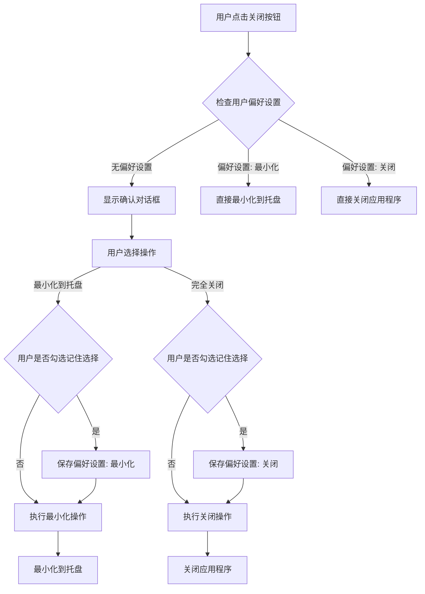

# 设计文档

## 概述

本设计文档描述了为 Mousy 应用程序实现关闭确认对话框功能的技术方案。该功能将在用户点击关闭按钮时提供选择，允许用户选择最小化到托盘或完全关闭应用程序，并支持记住用户选择以及防止重复启动实例。

## 架构

### 技术栈
- **主进程**: Electron (TypeScript)
- **渲染进程**: Vue 3 + TypeScript + Element Plus
- **配置存储**: JSON 文件 (user_config.json)
- **进程间通信**: Electron IPC

### 架构图



## 组件和接口

### 1. 主进程组件 (electron/main.ts)

#### 单实例检测器 (SingleInstanceManager)
```typescript
class SingleInstanceManager {
  static checkSingleInstance(): boolean
  static handleSecondInstance(): void
}
```

#### 关闭行为管理器 (CloseActionManager)
```typescript
interface ClosePreference {
  action: 'minimize' | 'close'
  rememberChoice: boolean
}

class CloseActionManager {
  static getClosePreference(): ClosePreference | null
  static saveClosePreference(preference: ClosePreference): void
  static clearClosePreference(): void
  static handleWindowClose(event: Event): void
}
```

#### 对话框服务 (DialogService)
```typescript
interface CloseDialogResult {
  action: 'minimize' | 'close' | 'cancel'
  rememberChoice: boolean
}

class DialogService {
  static showCloseConfirmationDialog(): Promise<CloseDialogResult>
}
```

### 2. 渲染进程组件

#### 关闭确认对话框组件 (CloseConfirmationDialog.vue)
```typescript
interface CloseDialogProps {
  visible: boolean
}

interface CloseDialogEmits {
  confirm: [action: 'minimize' | 'close', rememberChoice: boolean]
  cancel: []
}
```

#### 设置页面组件更新
在现有设置页面中添加重置关闭偏好的选项。

### 3. 配置管理

#### 配置结构扩展
```typescript
interface UserConfig {
  // 现有配置...
  closePreference?: {
    action: 'minimize' | 'close'
    rememberChoice: boolean
  }
}
```

### 4. IPC 通信接口

```typescript
// 主进程 -> 渲染进程
interface MainToRenderer {
  'show-close-dialog': () => void
  'close-dialog-result': (result: CloseDialogResult) => void
}

// 渲染进程 -> 主进程
interface RendererToMain {
  'close-dialog-response': (result: CloseDialogResult) => void
  'reset-close-preference': () => void
  'get-close-preference': () => void
}
```

## 数据模型

### 关闭偏好设置模型
```typescript
interface ClosePreference {
  action: 'minimize' | 'close'        // 用户选择的关闭行为
  rememberChoice: boolean             // 是否记住选择
  timestamp?: number                  // 设置时间戳（可选）
}
```

### 对话框状态模型
```typescript
interface DialogState {
  visible: boolean                    // 对话框是否可见
  selectedAction: 'minimize' | 'close' // 当前选择的操作
  rememberChoice: boolean             // 是否勾选记住选择
}
```

## 错误处理

### 1. 配置文件错误处理
- **文件不存在**: 创建默认配置文件
- **JSON 解析错误**: 记录错误日志，使用默认设置
- **权限错误**: 提示用户检查文件权限

### 2. 单实例检测错误处理
- **检测失败**: 记录警告日志，允许应用程序继续启动
- **通信失败**: 使用备用方法显示现有实例

### 3. 对话框显示错误处理
- **渲染进程未响应**: 使用系统原生对话框作为备用方案
- **IPC 通信失败**: 记录错误并使用默认行为（最小化到托盘）

### 4. 托盘操作错误处理
- **托盘创建失败**: 记录错误日志，禁用托盘功能
- **图标加载失败**: 使用默认系统图标

## 测试策略

### 1. 单元测试
- **CloseActionManager**: 测试偏好设置的保存、读取和清除
- **SingleInstanceManager**: 测试单实例检测逻辑
- **DialogService**: 测试对话框显示和结果处理
- **配置管理**: 测试配置文件的读写操作

### 2. 集成测试
- **主进程与渲染进程通信**: 测试 IPC 消息传递
- **窗口关闭流程**: 测试完整的关闭确认流程
- **托盘交互**: 测试托盘菜单和双击行为
- **单实例检测**: 测试多实例启动场景

### 3. 端到端测试
- **用户交互流程**: 模拟用户点击关闭按钮的完整流程
- **偏好设置持久化**: 测试重启应用程序后偏好设置的保持
- **异常场景**: 测试配置文件损坏、权限不足等异常情况

### 4. 性能测试
- **启动时间**: 确保单实例检测不显著影响启动时间
- **内存使用**: 监控对话框组件的内存占用
- **响应时间**: 测试关闭操作的响应速度

## 实现细节

### 1. 单实例检测实现
使用 Electron 的 `app.requestSingleInstanceLock()` API 实现单实例检测，当检测到第二个实例时，激活现有实例的主窗口。

### 2. 关闭行为实现
重写现有的 `win.on('close')` 事件处理器，根据用户偏好设置决定是否显示确认对话框。

### 3. 配置持久化实现
扩展现有的 `user_config.json` 文件结构，添加 `closePreference` 字段来存储用户偏好。

### 4. 对话框实现
使用 Element Plus 的 Dialog 组件创建自定义关闭确认对话框，提供清晰的用户界面和交互体验。

### 5. 托盘功能增强
基于现有的托盘实现，确保从托盘恢复窗口的功能正常工作，并在托盘菜单中提供完全退出选项。

## 安全考虑

### 1. 配置文件安全
- 验证配置文件内容的合法性
- 防止配置文件被恶意修改
- 使用安全的文件读写操作

### 2. IPC 通信安全
- 验证 IPC 消息的来源和格式
- 防止恶意渲染进程发送非法消息
- 使用类型安全的消息接口

### 3. 单实例检测安全
- 防止恶意程序绕过单实例检测
- 确保实例间通信的安全性

## 兼容性

### 1. 操作系统兼容性
- **Windows**: 完整支持所有功能
- **macOS**: 适配 macOS 的窗口关闭行为
- **Linux**: 支持基本功能，托盘行为可能因桌面环境而异

### 2. Electron 版本兼容性
- 基于当前使用的 Electron 30.0.1 版本
- 确保 API 调用的向后兼容性

### 3. 现有功能兼容性
- 不影响现有的托盘功能
- 保持现有的窗口管理逻辑
- 兼容现有的配置文件结构